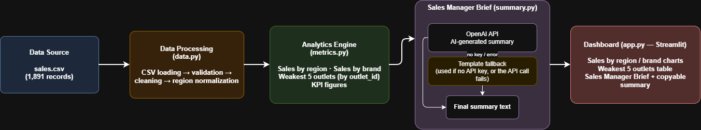

# Sales Analytics Dashboard

A Streamlit dashboard over `data/sales.csv` (Sep–Oct 2026, 1,891 invoice
line rows) that shows sales by region and brand, flags the 5 weakest
outlets, and writes a one-paragraph Sales Manager Brief ready to paste
into Telegram — AI-generated when an OpenAI key is configured, otherwise
a deterministic fallback built from the same numbers.

## Features

- **Sales by region** — table + bar chart, net sales per canonical region.
- **Sales by brand** — table + bar chart, net sales per brand.
- **5 weakest outlets** — lowest total net sales over the period, grouped by `outlet_id`.
- **Sales Manager Brief** — one-paragraph summary, AI-generated via OpenAI if `OPENAI_API_KEY` is set, otherwise a deterministic template built from the same figures. The UI shows which mode produced the text.

## Architecture



`data/sales.csv` → `data.py` (load, validate, clean: region
normalization, whitespace trim, numeric coercion) → `metrics.py`
(aggregate by region / brand / outlet) → `summary.py` (AI summary with a
template fallback) → `app.py` (Streamlit UI).

Editable diagram source: [`docs/architecture.drawio`](docs/architecture.drawio).

## Tech stack

Python 3, [Streamlit](https://streamlit.io/), [pandas](https://pandas.pydata.org/),
[openai](https://pypi.org/project/openai/) (`gpt-4o-mini`), [python-dotenv](https://pypi.org/project/python-dotenv/).
No database or backend — the CSV is read from disk on each run.

## Project structure

```
app.py               Streamlit UI
data.py               load_data(): read, validate, clean the CSV
metrics.py            sales_by_region / sales_by_brand / weakest_outlets
summary.py            build_summary(): AI or template Sales Manager Brief
data/sales.csv         Provided sales dataset
docs/architecture.png  Architecture diagram
requirements.txt      Python dependencies
.env.example          Template for OPENAI_API_KEY
```

`data.py` and `metrics.py` can be run directly (e.g. `python metrics.py`)
to execute their small built-in self-checks without starting the UI.

## Data processing & key decisions

- **Region normalization**: raw data has 10 region string variants (case
  differences plus the alias `Jabar`). `load_data()` trims, title-cases,
  and maps `Jabar` → `Jawa Barat`, then asserts the result is exactly the
  6 canonical regions. A regression is caught on load, not downstream.
- **Weakest outlets**: lowest total `net_sales_idr` grouped by
  `outlet_id`, not `outlet_name` — the name field has whitespace-only
  duplicates and isn't a reliable key.
- **Duplicates**: 3 exact duplicate rows (same date/invoice/outlet/SKU)
  are kept as-is — no business rule was given to collapse them, so they
  aren't silently dropped.
- **Missing values**: 5 rows have an empty `salesman` field; left
  untouched since no feature depends on that column.

## Setup & installation

### Prerequisites
- Python 3.9+
- `pip`

### Clone and set up
```bash
git clone <repository-url>
cd sales-analytics-dashboard
```

**Windows (PowerShell)**
```powershell
python -m venv venv
venv\Scripts\Activate.ps1
pip install -r requirements.txt
```

**macOS / Linux**
```bash
python3 -m venv venv
source venv/bin/activate
pip install -r requirements.txt
```

### Configure environment variables
```powershell
copy .env.example .env   # Windows
```
```bash
cp .env.example .env     # macOS / Linux
```
Optionally set `OPENAI_API_KEY` in `.env` (see below).

### Run
```bash
streamlit run app.py
```
Opens in your browser automatically, by default at `http://localhost:8501`.

## AI summary configuration

1. Copy `.env.example` to `.env`.
2. Set `OPENAI_API_KEY=<your-key>`. Never commit a real key — `.env` is
   git-ignored and for local use only.
3. Run the app. If the key is present and the API call succeeds, the UI
   shows an **"🤖 AI-generated"** badge above the brief.

If no key is configured, or the API call fails for any reason (network,
quota, invalid key), the app falls back to a deterministic template
built from the same numbers and shows a **"📐 Template"** badge instead.
The app always produces a usable summary with zero required setup.

## Usage

1. Start the app with `streamlit run app.py`.
2. **Sales by Region** / **Sales by Brand** show a table and bar chart each.
3. **5 Weakest Outlets** lists the outlets needing attention.
4. **Sales Manager Brief** shows the generated paragraph with its mode
   badge — select the text and copy it into Telegram or any chat tool.

## Data quality notes

From direct inspection of `sales.csv` (1,891 rows): 10 raw region labels
collapse to 6 canonical regions; outlet names have 3 whitespace-only
duplicates (handled by grouping on `outlet_id`); 3 exact duplicate rows
and 5 rows with a missing `salesman` value are present and kept as-is
(see decisions above). Net sales reconcile with gross minus discount for
all 1,891 rows — the underlying numbers are internally consistent.

## Limitations

- No CSV upload — the dataset path is fixed.
- No date-range filtering or trend-based outlet ranking (weakest = lowest
  total net sales for the full period).
- No authentication, persistence, or automated test suite beyond the
  inline self-checks in `data.py` and `metrics.py`.
- Runs locally only; not deployed to any hosting platform.
